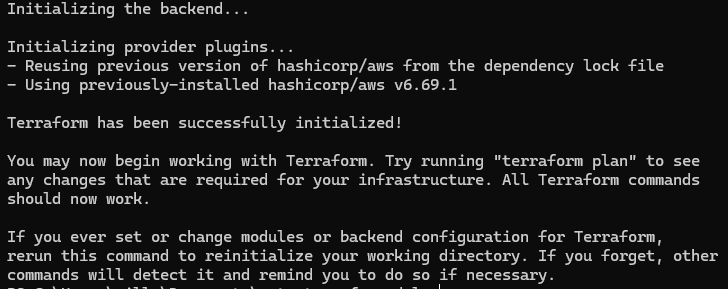
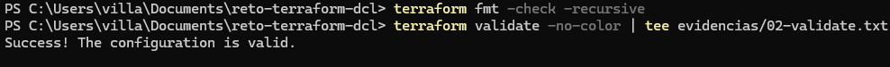
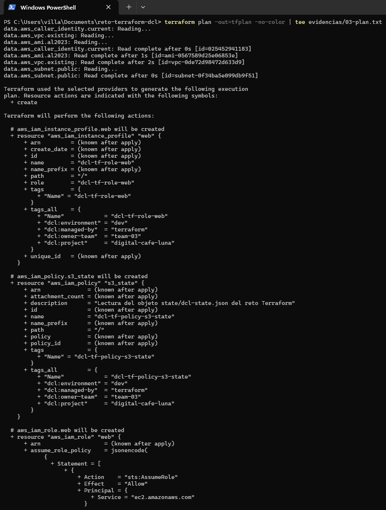
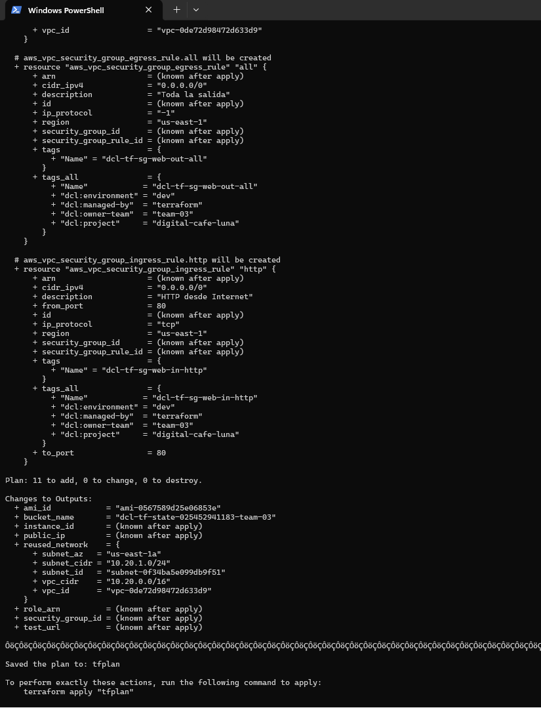
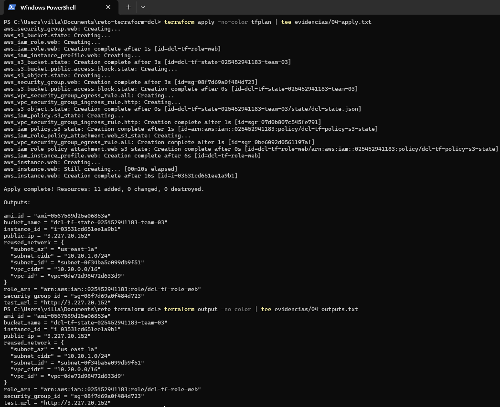
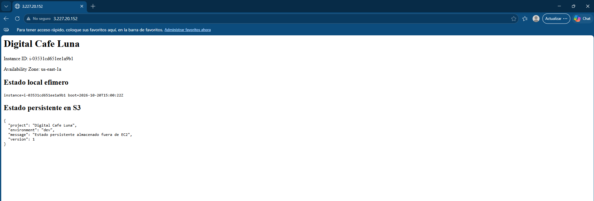
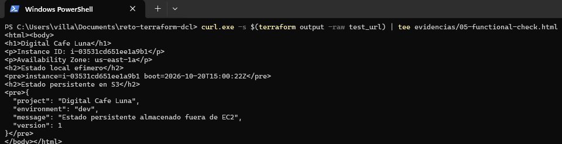
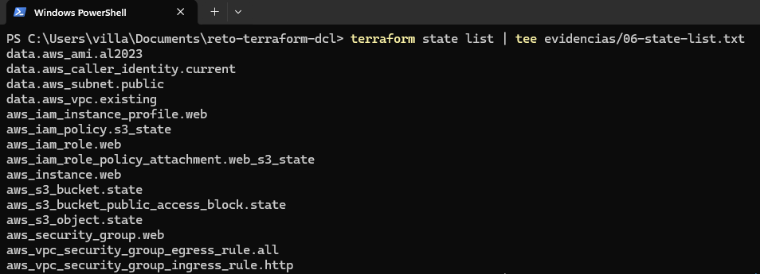
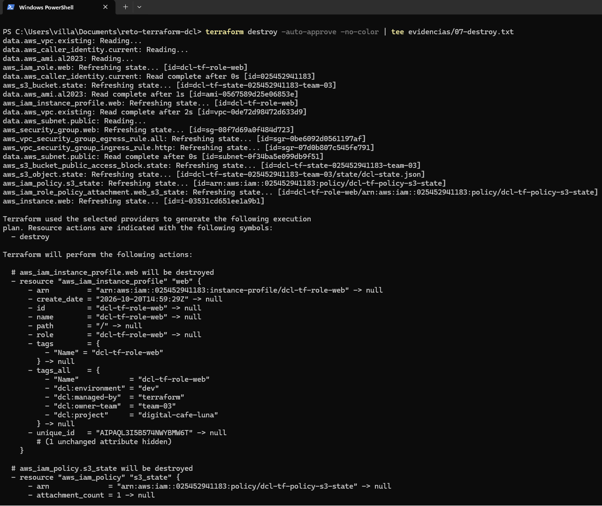
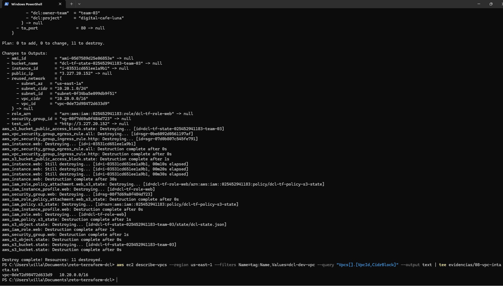

# Registro compacto de ejecución — team-03

Fecha de ejecución: `2026-10-20` · Responsable: `Mateo Villada` · Terraform `v1.16.6` · Provider `hashicorp/aws v6.69.1` · Región `us-east-1`

Cuenta AWS estándar personal. La red base no existía en esa cuenta, así que se creó antes con `red-base/` (5 recursos, state propio y separado del reto) y se eliminó al final, después del destroy del reto.

| Gate | Resultado | Evidencia / referencia |
|---|---|---|
| terraform init | PASS | `01-init.png` — "Terraform has been successfully initialized!" |
| terraform validate | PASS | `02-validate.png` — "Success! The configuration is valid." (además `terraform fmt -check -recursive` sin diferencias) |
| terraform plan | PASS | `03-plan-1.png`, `03-plan-2.png` — "Plan: 11 to add, 0 to change, 0 to destroy."; la VPC y la subnet aparecen solo como `data.*` |
| terraform apply | PASS | `04-apply.png` — "Apply complete! Resources: 11 added, 0 changed, 0 destroyed."; `test_url = http://3.227.20.152` |
| functional check | PASS | `05-functional-check.png` (navegador), `05-functional-check-terminal.png` — la página muestra Instance ID `i-03531cd651ee1a9b1`, AZ `us-east-1a`, el estado local y el JSON leído de S3 (sin el mensaje de error) |
| terraform destroy / cleanup | PASS | `06-state-list.png` — solo 4 `data.*` y los 11 recursos del reto, ningún `aws_vpc` ni `aws_subnet`; `07-destroy-1.png`, `07-destroy-2.png` — "Destroy complete! Resources: 11 destroyed." y, al final, `vpc-0de72d98472d633d9 10.20.0.0/16` sigue existiendo después del destroy |

Las evidencias no contienen access keys, secret keys ni tokens.

## Capturas

### 1. terraform init

### 2. terraform validate

### 3. terraform plan

### 4. terraform apply

### 5. Functional check

### 6. Cleanup

